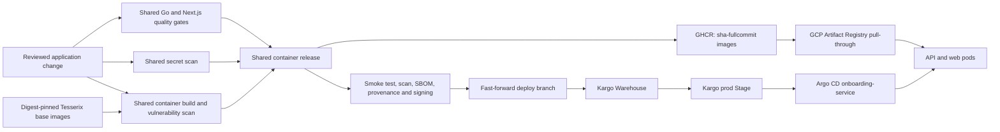

# Standard onboarding delivery

Status: historical two-workload delivery decision. The standalone web app is superseded by [console identity onboarding](https://github.com/tesserix/tesserix-home/blob/main/docs/adr/0058-console-identity-onboarding.md); current releases build only the retained private API.

The onboarding API and Next.js console are one product in `apps/api` and `apps/web`.
There is no demo application or mock API in the production source. Tests belong in
the language packages and release-contract tests in `tests/`. Dockerfiles live in
`deploy/`; test database setup lives in `scripts/ci/`. Database schema ownership
remains in tesserix-k8s; CI downloads an immutable, checksum-verified schema.

This change targets two images, two replicas per workload, one production namespace,
and approximately 1–10 releases/day. Kargo polls every five minutes; the target is
under ten minutes from verified images to healthy Argo sync, excluding image-build
queue time. No request path, API latency budget, database, replica count or tenant
boundary changes. Added steady-state cost is three small Kargo resources; image
build and retention costs depend on release frequency.

## Contracts

- Reusable workflows are pinned to immutable commits of `tesserix-workflows`.
- Node builder/runtime and Go builder/distroless bases come from
  `tesserix/base-docker-images`, pinned by digest. Renovate updates these pins;
  each update passes the same application and image gates.
- Next.js stays on version 16, Tailwind on version 4; pnpm is locked. All web
  format, lint, tests, types, production audit and build checks are mandatory.
- Go tests use real disposable PostgreSQL and serial packages because integration
  tests reset their shared database. The measured coverage baseline is 47.4%; the
  47% gate prevents regression, and is not a claim of comprehensive coverage.
- `.github/container-images.json` is the single image contract for PR builds and
  main releases. Web smoke checks `/healthz`; API route/database tests run in the Go
  gate. A standalone API container cannot boot without its identity/database
  dependencies, so its bare-image HTTP smoke is explicitly disabled rather than
  adding a test authentication mode to production.
- Main release requires every quality and container gate. Both images receive
  `sha-<full commit>` tags. `deploy` advances only after both published digests pass
  the shared release steps; no force push is used.
- Kargo watches `deploy`, never `main` or a lexically sorted image list. One
  promotion writes both `api.image.tag` and `web.image.tag` on the Argo Application.
- Only `kargo-onboarding:prod` is authorized. The platform parent ignores only this
  child's Helm parameters and respects that ownership during sync, preventing
  self-heal from reverting promotions.
- Images are pulled through the existing GCP mirror. Production remains on its
  prior images until verified release artifacts are available.

## Failure and recovery

A failed quality check, blocked GitHub runner, failed scan, or partial image publish
leaves `deploy` unchanged. A missing registry image therefore cannot become Freight.
Registry or Kargo outages delay delivery; existing pods continue serving. The
immutable tag makes retries converge on the same release. A failed Argo rollout
is visible through Kargo promotion status and deployment readiness; it does not
justify advancing another untested commit.

Roll back by explicitly approving and promoting the previously verified Freight.
For an initial cutover before historical Freight exists, retain the prior API/web
image identifiers in the release record and restore both through reviewed GitOps.
No database migration is part of this delivery change.

The direct hand-edited image-pin rollout was superseded by this flow. No repository
visibility change, new registry credential, skipped check, or production mock
endpoint is used to work around unavailable CI. GitHub billing and required PR
reviews must be resolved before claiming end-to-end delivery is complete.
